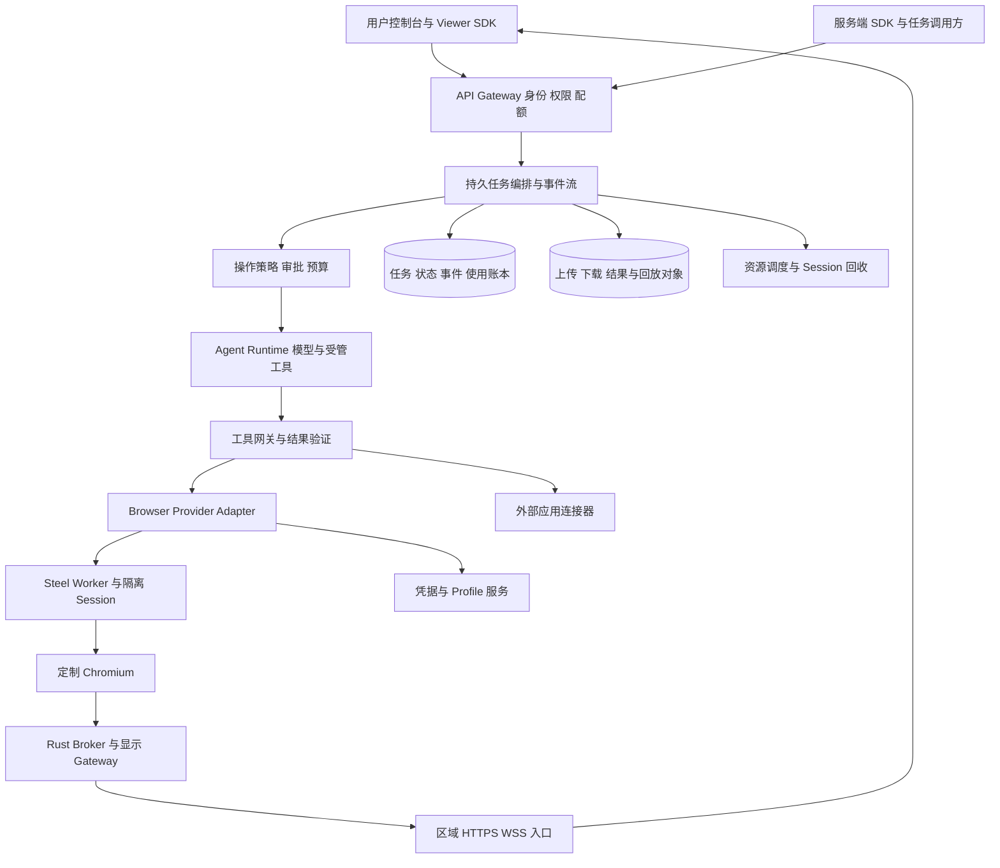

# Remote Paint 云 Agent 产品架构与上线路线

建议先做可观察、可接管、可恢复的云端浏览器 Agent：用户给出目标，Agent 在隔离浏览器中执行，遇到登录、业务确认或权限边界时交给用户，最后返回能核对的结果和产物。Remote Paint 负责低延迟观察和接管；任务执行、恢复、账号隔离与结果验证决定用户能否信任整个产品。

第一阶段建议面向开发者提供 Session 与任务 API，同时提供少量网页任务模板和用户控制台。等浏览器任务的稳定性与成本成立后，再扩展终端、代码、桌面应用和完整云工作区。这些执行环境需要各自的隔离、文件和权限模型。

## 已有能力和产品边界

当前已完成定制 Linux ARM64 Chromium、原生 SKP/Viz 数据面、Rust Broker/Gateway、CanvasKit Worker、输入租约，以及 Linux 与 Mac 的运行验收。真实像素输入延迟为 48.8/57.8 ms p50/p95；这证明显示和交互链路能工作。

当前 `startLive()` 自行启动一个浏览器和页面，控制端与 Viewer 主要围绕本机运行；尚未接入真实 Steel Session。控制租约管理 `source.control.agent()`，外部无限制 CDP 不自动受它约束。公共 SDK、多租户控制面、持久任务系统、Agent 执行器和商业计费仍是新增工作。详见[当前验收](native-final-acceptance.md)、[Steel 接入边界](roadmap.md#steel--gateway-的接入契约)和[完整优化清单](optimization-backlog.md)。

远程画面、浏览器基础设施和云 Agent 是三个可独立组合的能力：

| 能力层 | 对外承诺 | 建议定位 |
| --- | --- | --- |
| Remote Paint | 观察和接管远端页面，管理显示协议与资源 | 可复用的显示组件，按能力协商嵌入 |
| Browser Cloud | 创建、连接、隔离、保留与释放浏览器 Session | Steel adapter 加平台生命周期与授权 |
| Agent Runtime | 完成任务、等待用户、恢复执行、验证结果 | 产品核心，不能只靠 Viewer 和一个聊天框替代 |
| Cloud Workspace | 终端、代码、文件系统、桌面和更多工具 | 后续独立执行环境，按任务需要接入 |

## 用户应该能完成的完整流程

1. 用户创建任务，选择账号 Profile、允许访问的网站、预算和允许的操作。
2. 平台分配就近的隔离 Session，恢复经过授权的登录状态，并记录运行版本。
3. Agent 获取任务相关观察，制定步骤，通过受管工具执行；控制台展示进度和可解释的操作记录。
4. 用户随时打开 Viewer 查看，可申请接管；Agent 在明确交接点暂停写操作。
5. 登录、MFA、验证码或敏感业务确认需要人工时，任务持久进入等待状态并通知用户；敏感字段不进入普通模型上下文。
6. 用户完成操作并归还控制权后，Agent 重新观察页面和当前权限，再继续，不能沿用过期坐标或元素引用。
7. 每一步根据业务后置条件验证。例如上传成功以远端文件记录确认，提交成功以业务记录和返回 ID 确认。
8. 最后返回结构化结果、文件、来源与执行记录；失败时给出失败步骤、可恢复状态和已发生的副作用。
9. 浏览器、凭据、临时文件和计费按约定保留或释放；用户能取消任务、删除数据并撤销授权。

## 建议架构



控制面管理用户、权限、任务、计费与 Session。执行面运行 Agent、工具和网页。绘图数据面继续由 C++、Rust 与客户端 Worker 负责，不让模型服务或任务数据库转发每一帧。Node 或其他后端语言可以继续承载控制面，是否换语言应依据实际瓶颈。

浏览器服务与 Agent 服务通过 provider adapter 和工具契约连接。先接实际使用的 Steel revision，验证创建、连接已有 target、导航、弹窗、多标签、Profile 和销毁；不能让 Viewer 与 Agent 各自打开一个看似相同、实际状态不同的页面。

## 产品能力清单

P0 是受控云端内测或对外使用的前置能力，P1 是扩大使用、团队协作和付费运营所需能力。具体先后还需按首个客户工作流缩小范围。

| 编号 | 能力 | 必须解决的问题 | 阶段 |
| --- | --- | --- | --- |
| P1 | 账号 组织与权限 | 用户、租户、成员、角色、API key、短时 Viewer ticket；只读观察、接管、任务执行和管理员权限分开。 | P0；企业 SSO 可 P1 |
| P2 | Session 生命周期 | 创建、连接、心跳、TTL、空闲回收、配额、页面 target、退出原因、版本和区域；取消或失联后不留下僵尸浏览器。 | P0 |
| P3 | Steel 与 Provider 集成 | 绑定已有 Session 和同一 target，支持代理、Profile、上传下载、弹窗、多页与关闭；所有写操作遵守同一租约。 | P0 |
| P4 | 登录与凭据 | 加密保存 Profile、Cookie、OAuth token 与授权范围；人工处理登录、MFA 和授权更新。密钥通过受控执行路径注入，不直接放到模型提示或 Viewer URL。 | P0 |
| P5 | Agent 执行器 | 模型路由、结构化工具、计划与执行循环、停止条件、错误分类、模型上下文和 token 预算；输出实际行动记录。 | P0 |
| P6 | 持久任务与恢复 | 队列、状态机、步骤日志、Worker 租约、心跳、超时、取消和重启恢复；关闭控制台不等于取消任务。 | P0 |
| P7 | 幂等与结果验证 | 工具调用 ID、幂等键、业务后置条件、结果未知状态、补偿和人工核对。已执行副作用不能因为回执丢失而盲目重做。 | P0 |
| P8 | Agent 的观察能力 | DOM/AX、元素、截图、网络和文件观察按任务授权；控制观察大小和刷新频率，绑定 page epoch 与来源。 | P0 |
| P9 | 多 Agent 协作 | 规划、研究、执行和验证角色共享可追溯事件；一个页面默认只有一个写者，多页或多 Session 才做独立并发。 | 基本写者约束 P0，复杂协作 P1 |
| P10 | 人工接管与等待 | 查看、接管、归还、共享只读观察；任务进入 waiting_user，记录交接点，Agent 重新观察后续跑。 | P0 |
| P11 | 敏感操作审批 | 发送、付款、删除、发布和外部授权的策略由服务端执行；审批绑定动作参数、对象、期限和任务版本，参数变化需重新评估。 | P0 对已开放动作 |
| P12 | 文件和任务产物 | 上传、下载、导出、预览、对象权限、到期链接、大小预算、扫描与保留期限；产物与任务、步骤关联。 | P0 |
| P13 | 外部工具与连接器 | 按需接企业 API、搜索、邮件、日历、代码仓库或 MCP；凭据独立授权、最小范围、可撤销，外部调用有幂等与限流。 | 首个工作流 P0，扩展 P1 |
| P14 | 回放与可追溯性 | 保存动作、步骤、观察摘要、批准记录、必要关键帧和文件来源；按保留策略录制与脱敏。可解释发生了什么，不声称能确定性重演整个互联网。 | P0 基础事件，P1 完整诊断 |
| P15 | 运行与网络隔离 | 隔离租户的进程、文件、网络、Profile 与凭据；限制云元数据、内网、控制服务、重定向和 DNS 重绑定等越界访问。 | P0 |
| P16 | 不可信内容与执行策略 | 网页、文档、工具结果和任务指令分级；页面内容不能修改系统权限或批准自身操作。凭据、动作和预算最终由可信后端裁决。 | P0 |
| P17 | 调度与容量 | 就近区域、资源池、预热、公平排队、并发配额、背压、过载保护和回收；Agent 与浏览器的资源分别核算。 | P0 基础，P1 多区域 |
| P18 | 运维与质量 | 全链路 trace、成功率、等待原因、首帧、任务耗时、失败分类、SLO、告警、版本回滚和故障排查入口。 | P0 |
| P19 | 成本与计费 | token、工具、浏览器活跃及保留时间、代理、显示下行、存储分别记账；预算预警、硬上限、账单解释和支付。 | P0 内部账本，P1 商业支付 |
| P20 | 开发者与用户控制台 | 任务列表、状态与回放、结果、Profile、凭据、审批、Viewer、用量、配额和 SDK 文档；提供模板与可复现示例。 | P0 最小闭环，P1 完整团队协作 |

## 任务可靠性应怎么实现

### 持久状态与执行租约

任务状态至少区分 `queued → allocating → running → succeeded / failed / cancelled`，并支持 `waiting_user`、`waiting_external`、`cancel_requested`。每次转移写入数据库和有序事件；Worker 重启后从持久状态恢复，旧 Worker 的过期执行租约不能继续提交新步骤。

Task 表示用户的目标，Run 表示一次执行尝试，Step 表示可恢复工作单元，ToolInvocation 表示一次外部动作。不要将这四个概念都塞进一个内存 Promise。

| 数据对象 | 关键用途 |
| --- | --- |
| Tenant 与 User | 所有授权、配额和数据的归属 |
| Profile 与 SecretRef | 持久登录状态和密钥引用，带访问范围与版本 |
| Session 与 PageTarget | 实际浏览器资源、区域、运行版本、epoch 与租约 |
| Task 与 Run | 用户意图、预算、一次执行、状态、取消和失败原因 |
| Step 与 ToolInvocation | 工具参数、幂等键、前置状态、执行结果及结果未知标记 |
| Approval | 人工批准的确切动作和对象，不能只记录一个通用“已允许”布尔值 |
| Artifact | 结果文件、来源、hash、访问控制和保留期限 |
| Event 与 UsageEvent | 有序进度、审计、去重和费用账本 |

数据库事务配合 outbox 或成熟持久工作流引擎解决状态和事件的一致性；队列只负责派发，不代替数据库事实。初期选一种可运维方案即可，不必同时引入多套消息系统和调度框架。

### 重试和业务副作用

读取页面可以安全重试的范围较大，付款、发信、提交工单或删除对象则不同。例如“服务器已提交，连接在返回 ID 前断开”应进入结果未知，优先查询业务结果或请求人工核对。外部系统支持幂等键时使用其机制；不支持时，不能声称端到端 exactly once。

每个工具定义前置条件、权限、超时、可重试性、副作用类型、验证方式和取消边界。取消表示不再开始后续工作，已经执行的网页 JS 和外部操作不会自动回滚。

### 恢复的真实含义

保存任务状态、步骤、文件与授权 Profile 可以支持重新执行和续跑，但 Profile 不等于浏览器进程快照。浏览器崩溃后，JS 堆、WebSocket、尚未提交的表单和内存页面状态可能丢失。恢复时要重新建立页面、重新观察，并处理尚未确认的副作用。

暂停等待用户、停止绘图编码、暂停整个网页、保留浏览器内存和释放 Session，是五种不同操作。无人观看时可以停止显示流，但不能让 Agent 依赖的 RAF、动画、截图或页面准备流程失去进度。云 API 应把这些生命周期语义写清楚。

## 多 Agent 应怎么组织

先采用一个协调者、一个页面执行者和一个独立验证者。协调者拆解目标与分配预算，执行者持有页面写租约，验证者检查结果。研究 Agent 可以在独立只读工具或独立浏览器环境中并行，避免多个 Agent 同时争用一个页面。

共同上下文应是任务事件、带来源的观察和产物引用。对话摘要可以帮助规划，但不能取代业务状态。跨租户和跨任务的长期记忆需要明确授权、保留和删除策略。

所有可修改页面的工具都要通过同一控制栅栏，包括导航、点击、输入、脚本执行、文件上传、页面关闭和某些网络操作。只约束鼠标键盘、同时给 Agent 一条不受限的 CDP 连接，会使人工接管失去实际意义。

## 云端运行的安全前置条件

当前本地启动参数含 `--no-sandbox`，Linux 验收采用软件合成。对外运行不可信网页前，需要验证并恢复合适的 Chromium sandbox，并提供明确的 Session 或租户隔离边界；容器、微虚拟机和进程隔离如何组合，应依据威胁模型与启动成本测试。BrowserContext 是状态隔离手段，不能单独当作强租户安全边界。

生产环境至少需要以下约束：

- Viewer、任务 API、Agent 工具和内部 IPC 分别授权。Unix socket、浏览器调试端口和宿主控制端口不向网页或公网开放。
- 目标 URL、跳转、DNS 解析、IPv4/IPv6 和实际连接目的地都受出口策略约束；授权访问企业内网使用单独的连接器或隔离部署。
- 凭据通过 SecretRef 和受限执行路径使用，日志、模型上下文、回放及下载文件各自做权限与保留管理。
- 解码器对 SKP、字体和图片设置尺寸、内存、复杂度、耗时与崩溃恢复预算；继续做模糊测试与故障注入。
- Profile、Cookie、文件、资源缓存与回放按租户和 Session 的约定隔离。内容 hash 用于完整性与去重，不是授权凭据。
- 网页内容只作为观察数据，不能更改可信策略、提高工具权限或授予付款和外发许可；审批由服务端绑定参数执行。
- 定制 Chromium、Skia、CanvasKit、Rust 与依赖持续更新，保留签名、SBOM、许可证、来源和回滚路径；设配额与滥用处理能力。

绘图流不发送源 HTML 或 Cookie，不代表里面没有敏感信息：页面可见文字、图片、字体资源和录屏仍可能包含私有数据。TLS、对象权限、端点授权和数据保留策略仍然需要完整设计。

## Agent 自身的性能和成本优化

48 ms 的远端画面延迟只解释人工交互的一部分。Agent 一步任务还可能等待模型生成、页面网络、工具调用和业务完成；应先统计整个任务的耗时分布，确定瓶颈。

| 优化方向 | 建议做法 |
| --- | --- |
| 减少无效模型调用 | 以步骤和页面事件触发观察，等待明确条件；不要将 60 FPS 画面变成每秒几十次模型调用。 |
| 控制观察 token | 优先任务相关 DOM/AX、文本和元素范围；截图按需或按变化区域提供，附版本和坐标。 |
| 模型分工 | 简单分类与提取可选低成本模型，困难决策使用能力更强模型；以任务成功率、重试和总成本评估路由。 |
| 优先直接业务 API | 获得相同授权且 API 可用时，用结构化工具完成；需要网页状态或人工接管时再用浏览器。 |
| 并行独立工作 | 多个检索、文件处理或独立 Session 可并行；同一页面的有副作用动作有序执行。 |
| 停止条件 | 限制步骤数、重复失败、空转时间和预算；达到边界转等待或失败，避免无限重试。 |
| 缓存与记忆 | 按租户、权限、模型和任务版本缓存可复用上下文；不要重用过期页面状态或跨租户私有观察。 |
| 无人观看 | 停止持续 Viewer 编码与下行；保留 Agent 所需的按需观察、页面进度和关键步骤证据。 |

成本账本至少拆成：

```text
单任务成本 = 浏览器计算 + Agent 计算 + 模型 token + 外部工具
           + 网络与代理 + Viewer 下行 + 文件和回放存储
```

浏览器活跃执行、等待用户时保留 Session、持续观看和长期 Profile 存储的成本不同，配额与计费应分别体现。当前动画流外推约 3.66 GB 每活跃观看小时，意味着显示下行需要独立计量；不能只按模型 token 定价。历史短时 CPU/RSS 数据不足以计算真实云端会话密度或毛利。

## 建议的首版范围

先选三个能验证结果的工作流，例如网页资料采集并生成文件、后台表单填写至待确认、业务查询并生成结构化报告。它们覆盖导航、登录、文件、等待和结果验证，容易观察任务究竟成功在哪一步。

| 阶段 | 要交付什么 | 进入下一阶段的依据 |
| --- | --- | --- |
| 内部闭环 | 一个实际 Steel provider、最小任务状态机、单执行者、Viewer 接管、登录 Profile、产物与基础账本 | 浏览器/Worker 故障、断线、取消、人工交接均有定义和恢复证据；目标工作流成功结果可核对 |
| 受控云端内测 | 身份与租户边界、隔离和出口策略、短时 ticket、SDK、预算、审批、文件权限、基础告警 | 独立租户隔离测试、权限与失败注入通过；目标浏览器和真实公网可用；定制浏览器版本可回滚 |
| 对外付费测试 | 计费支付、用量解释、团队控制台、资源公平调度、任务质量回归、支持和事故流程 | 任务成功率与每成功任务成本达到业务目标；错误计费和副作用重复有验证；容量与账单符合实际压力测试 |
| 规模化扩展 | 多区域、更多 provider、连接器、复杂协作、企业网络与云工作区 | 有真实需求、数据隔离设计和可解释成本；按功能逐项验收 |

基础任务、Session、授权与事件 API 应从首版就可测试，但企业 SSO、全平台桌面、任意应用、多模型市场和无限多 Agent 协作可以后置。首版优先把有限工作流做成可恢复的闭环。

## 上线验收应覆盖的失败情形

| 类别 | 需要主动验证的情况 |
| --- | --- |
| 任务恢复 | 进程在工具调用前、动作执行后、结果落库前分别退出；旧 Worker 恢复后不能重复提交 |
| 控制交接 | 人工在 Agent 导航、输入、上传和等待时接管；旧 lease、旧 epoch 和排队写操作被拒绝 |
| 业务结果 | 动作返回成功但业务拒绝，页面超时但操作已成功，结果未知后核对而不盲目重做 |
| 权限 | 其他租户 ticket、过期链接、已撤销凭据、跨任务文件、缓存命中与回放访问 |
| 网络 | 真实公网 RTT、连接代理、断线、TLS/WSS、入口切换与退出 draining |
| 网站兼容 | 目标站点的 iframe、弹窗、下载、上传、富文本、视频和回退；登录与验证码的人工流程 |
| 资源与费用 | Agent 空转、Viewer 断开、任务取消、用户长时间不回应、资源池耗尽、用量事件重复与丢失 |
| 长时与升级 | 长任务、Profile 到期、凭据撤销、浏览器升级、协议错配、GPU/Worker/Broker 崩溃 |

建议给每个目标工作流维护真实可核对的验收样本和不可自动重做的副作用说明，分别统计首次成功、恢复后成功、人工介入比例、业务错误、每成功任务成本与完成时间。模板任务通过不应被解释成任意网站的通用自主能力。
