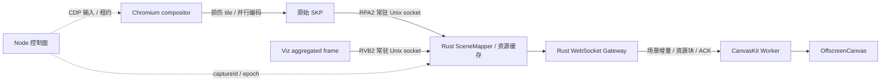

# 原生数据面与 1–8 项优化

控制面由 Node 管理 Session、鉴权、控制租约、CDP 输入和网页生命周期。绘图数据面由 Chromium C++、Rust Broker/Gateway 和 Viewer Worker 承担。生产默认路径不在 Node 中解析 Viz 场景、重编码 SKP、去重资源或构造 Peer 帧；`REMOTE_PAINT_DATA_PLANE=node` 保留兼容对照路径。

| 项目 | 实现 | 验证入口 |
| --- | --- | --- |
| 1 自适应 BeginFrame | 活动时约 60 Hz；12 次无损伤后降至 10 Hz；输入立即唤醒；启动阶段保留网页准备时钟；首次连接后，无 Viewer 停止外部时钟 | `tests/begin-frame.test.mjs`、Linux BeginFrame/live 验收 |
| 2 输入关键路径 | CDP 输入接受后立即请求采集；可选的乐观 DOM 读并行执行；输入序号在采集开始采样 | `tests/input.test.mjs`、真实输入/延迟验收 |
| 3 Viewer 增量 | 未变化 pass 复用；每个不可变 SKP 栅格化一次；8M 像素 LRU；依赖变化向父 pass 传播 | `tests/scene-renderer.test.mjs`、真实 Viewer |
| 4 选择性隔离 | C++ 保守分析 clear/Src/自定义 blend/saveLayer 等操作；安全 picture 可直接绘制，破坏性 picture 保留透明隔离 | serializer native tests、透明 clear/嵌套 alpha 回归 |
| 5 变化内容/资源 | 累积所有 compositor commit 的损伤；256×256 tile 只重录受影响区域；线程安全字体子集/图片编码缓存；字体/图片块跨 SKP 复用 | `verify-broker-tiles`、native helper self-test、资源/像素验收 |
| 6 Worker | WS、并行 SHA 校验、场景门控、CanvasKit 重放和 OffscreenCanvas 均在 Worker；主线程处理 DOM/输入；保留 `?mainThread` 对照 | `verify:viewer`、`verify-broker-gateway` |
| 7 常驻二进制 IPC | RVB2 场景 + RPA2 原始资源直接从 Chromium 到 Rust；Node 只接收完成通知；不经 CDP Base64 | `verify-broker-viz`、`verify-broker-resources`、完整 native live |
| 8 多 Viewer 复用 | Rust Arc/Bytes 共享资源与完整场景序列化；每个 ACK 基线的 delta 计算一次；每 Peer 独立资源引用、ACK、恢复与超时 | 两个实际 Worker Viewer、慢客户端、Mac 单/双 Viewer 运行指标 |

这里的“增量字体”是不可变子集/图片编码复用和独立资源块缓存。新增 glyph 超出已缓存子集时仍生成新子集；客户端不重新执行 shaping，也不合并字体内部表。Glyph ID、布局和字形位置继续来自源 Chromium。

## 私有 IPC

Unix socket 位于权限 0700 的临时目录，socket 权限 0600；最多四条连接。两类包都以前置大端 u32 长度分帧，允许连续包及任意分片。

- `RVB2 01 01`：captureId、命名空间、pass/quad 和裁剪/变换等标量。场景上限 256 KiB、64 pass、合计 2048 quad。
- `RPA2 01 01`：captureId、无 SKP 的 JSON 资源描述、原始资源块。每个块携带 SHA-256；16 MiB/资源、64 MiB/采集、最多 256 条资源。资源描述上限 4 MiB，总包上限 72 MiB。

Broker 先登记 captureId，分别配对 Viz 与资源，不把未登记包用于映射。两者可任意先后到达；丢失资源会超时失败。导航/viewport 使旧逻辑场景失效；有界不可变缓存跨 epoch 保留，显式 full reset 才清除资源。最多保留四个待发布快照，并拒绝将旧 serial 覆盖到新快照。

## Viewer 资源块协商

Hello 的 `capabilities: ["asset-chunks-v1"]` 启用块传输。RPNT v1 kind 2 是带 SHA-256 的独立块，kind 1 保留完整 SKP 兼容模式。`ResourceManifest` 给出完整 SKP 的 hash、长度和有序块引用；字体和图片按原始编码边界拆分，其余指令每 32 KiB 拆分。Worker 必须验证每块 SHA、重组长度、SKP magic 和完整 SKP SHA，然后才能进入场景提交门控。

Peer 只发送该连接尚未获得的块；旧 SKP 释放后仍可复用其字体/图片。服务端历史块超过 64 MiB 或 32768 项时，发送有序 `ChunkCacheReset`；客户端块缓存硬上限为 128 MiB/131072 项。场景资源缓存另有 128 MiB/512 项限制。缺依赖时保持上一帧并请求完整关键帧；校验失败关闭连接。主线程兼容 Viewer 不协商分块。

## 控制与限流

Viewer HTTP 及原生 WS 使用相邻端口，例如 4176/4177，都只映射到 Mac loopback。WS 校验 UI Origin 和随机密钥；版本、CanvasKit 和 Wasm SHA 不匹配以 1008 关闭。最多四个 Viewer，各仅一帧等待 ACK；ACK 超时以 1013 关闭。客户端消息最大 32 KiB，最多 512 条/秒，原生控制队列最多 64 项。坏 JSON、异常 ACK、未支持消息和二进制输入以 1008 拒绝。

## 测量边界

`native.timing` 分别记录 recording、并行编码墙钟、各层工作耗时总和、结果组装、CDP 回复、Viz 等待及采集往返。多层 font/image/serialize 的总和不能直接相加当作串行关键路径。

Mac 的输入探针在 keydown 后采样已经提交给 HTML canvas 的真实像素，支持 OffscreenCanvas，不以 InputAck 或乐观覆盖层代替原生像素。Linux proof 强制要求 Rust 数据面和实际 Worker Viewer，并记录进入 Node 的资源记录/Viz 场景数必须为零。单/双 Viewer 两秒窗口记录源采集 FPS、每 Peer 发送 FPS/带宽、Mac Worker 实际呈现 FPS/重放耗时、Node/Broker/Chromium 进程 CPU 核当量及 RSS 总和；缺失或非有限指标不能通过验收。RSS 包含进程间共享页的重复计数，不能等同于物理独占内存。

Fixture 测试仅证明各自协议、缓存或 Viewer 边界。完整 Linux 重编、Linux native 套件和 Mac Viewer 验收通过前，不将旧版 150ms 左右的结果或 fixture 的 2–3ms 重放时间当成新链路端到端结果。
